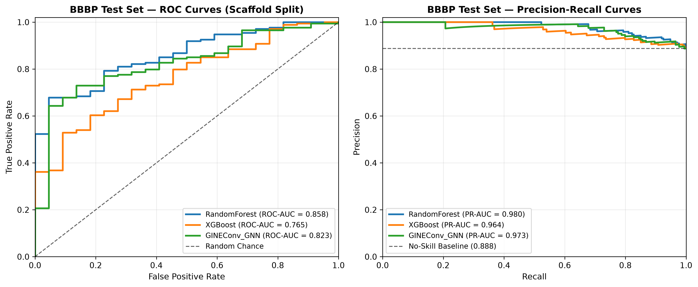
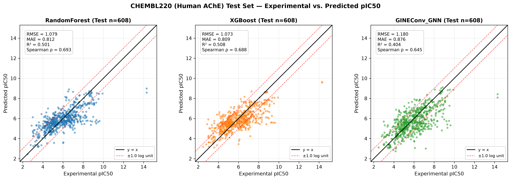
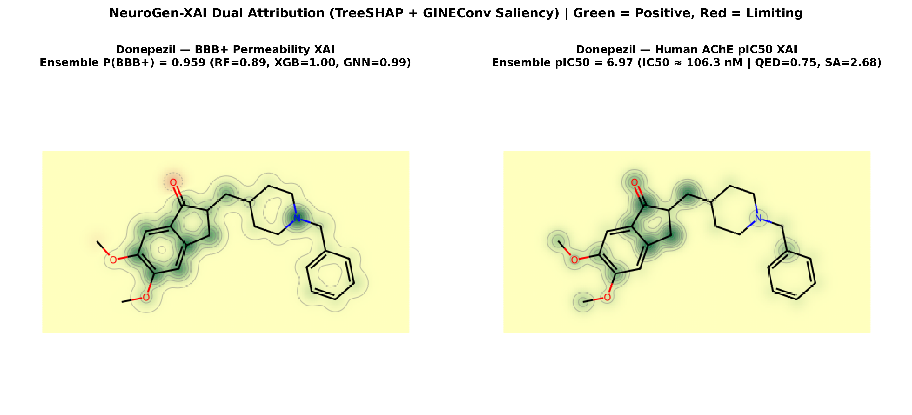
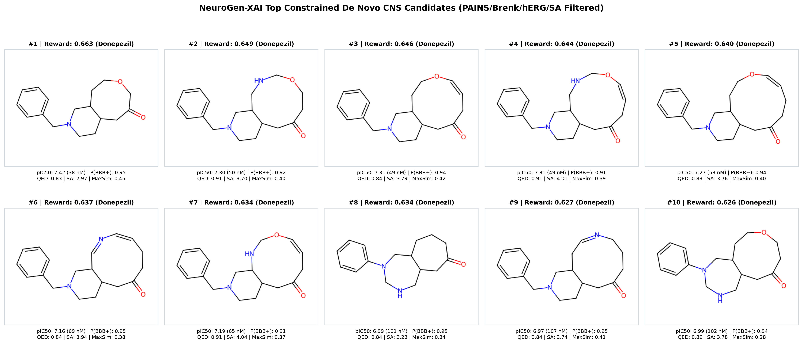

# NeuroGen-XAI: The Complete Project Story & Technical Guide

*How raw chemical strings become explainable, synthesizable, brain-penetrant CNS drug candidates.*

---

## Chapter 1: The Story — Why We Built NeuroGen-XAI

Imagine trying to send a rescue team to repair a power plant inside a high-security vault. Designing a medicine for **Alzheimer's disease** or any Central Nervous System (CNS) disorder faces two connected walls:

1. **The Target Inside the Brain (`CHEMBL220` — Human Acetylcholinesterase / AChE):**
   In Alzheimer's disease, the neurotransmitter *acetylcholine* breaks down too fast, impairing memory and cognition. Blocking the enzyme **Acetylcholinesterase (AChE)** slows that breakdown and helps preserve cognitive signaling.
2. **The Brain's Security Wall — The Blood-Brain Barrier (BBB):**
   The brain is wrapped in a tightly sealed vascular barrier (the **Blood-Brain Barrier**) that blocks >98% of small-molecule drugs and nearly 100% of large biologics. A molecule can be an extraordinary AChE inhibitor in a petri dish, yet completely useless in a patient if it cannot cross the BBB.

Even when traditional AI predicts *"Yes, this molecule crosses the BBB"* or *"pIC50 = 7.2"*, medicinal chemists still hit two roadblocks:
- **The Black-Box Problem:** A chemist cannot improve a molecule if the AI doesn't explain *which specific atoms or functional groups* helped or hurt brain penetration and potency.
- **The Synthesis & Safety Trap:** Naive generative AI often invents chemically impossible molecules, toxic Pan-Assay Interference Compounds (**PAINS**), or cardiotoxic **hERG** blockers.

**NeuroGen-XAI** solves all four challenges in a single unified pipeline:
1. **Curates** clean, standardized, leakage-free chemical datasets (**Phase 1**).
2. **Predicts** BBB permeability and AChE potency using an ensemble of tree models and a Graph Neural Network (**Phase 2**).
3. **Explains** every prediction down to individual atoms and physicochemical drivers using Dual-XAI (**Phase 3**).
4. **Invents** brand-new, synthesizable, alert-free CNS drug candidates via constrained SELFIES reinforcement/evolutionary generation inside a clinical White/Blue/Black Streamlit platform (**Phase 4**).

---

## Chapter 2: End-to-End System Architecture (Input -> Output)

Every time a chemist enters a molecule — represented as a **SMILES** string (e.g., Donepezil: `COc1cc2c(cc1OC)C(=O)C(CC1CCN(Cc3ccccc3)CC1)C2`) — here is the exact journey the data takes through the ML system:

1. **Input:** Raw SMILES string.
2. **Cleaning (`MolCleaner`):** Parse SMILES, strip salts (`LargestFragmentChooser`), neutralize charges (`Uncharger`), canonicalize SMILES.
3. **Dual Featurization:**
   - **Branch A (Tabular, 2056-dim):** `2048`-bit Morgan Fingerprint (`radius=2`) + `8` physicochemical descriptors (`StandardScaler` fit strictly on Train split).
   - **Branch B (Molecular Graph):** `46`-dim atom node features + `12`-dim bidirectional bond edge features + `8` standardized descriptors.
4. **6-Model Ensemble (`NeuroGenExplainer`):** Averages `RandomForest`, `XGBoost`, and `GINEConv_GNN` for both BBB+ probability and AChE $\text{pIC}_{50}$ (converted to $\text{IC}_{50} = 10^{9 - \text{pIC}_{50}}$ in nM), plus Lipinski Rule-of-5 compliance.
5. **Dual-XAI Attribution:** Fuses **TreeSHAP + RF active-bit ablation** (mapped to atoms via RDKit `bitInfo`) with **GINEConv Input*Gradient + Atom Occlusion** into $[-1, +1]$ atom weights rendered onto 2D RDKit `RdYlGn` heatmaps.
6. **Constrained SELFIES De Novo Design (`ConstrainedSELFIESGenerator`):** Mutates & crosses over CNS seeds in SELFIES space, rejects PAINS/Brenk/hERG/`SA_Score > 4.5` alerts and training-set duplicates, and optimizes the multi-objective reward.

---

## Chapter 3: Phase 1 — Data Curation & Bemis-Murcko Scaffold Splitting

**Code:** `src/data_pipeline/prepare_datasets.py`

1. **MoleculeNet BBBP (`bbbp_raw.csv`):** `2050` raw rows -> `-11` invalid SMILES, `-62` duplicates collapsed, `-22` conflicting binary labels dropped -> **`1955` unique molecules** (`1015` unique scaffolds; `1494` BBB+ / `461` BBB-).
2. **ChEMBL220 Human AChE (`chembl220_raw.csv`):** `7827` exact nM $\text{IC}_{50}$ records -> `-1` invalid SMILES, `-1485` duplicates aggregated by median $\text{pIC}_{50}$, `-269` high-variance replicates (`std > 1.0`) dropped -> **`6071` unique molecules** (`2547` unique scaffolds; $\text{pIC}_{50} = 5.956 \pm 1.492$).
3. **Bemis-Murcko Scaffold Split (80/10/10, 0 overlap):**
   - **BBBP:** `1564` Train (`624` scaffolds) / `195` Val (`195` scaffolds) / `196` Test (`196` scaffolds).
   - **CHEMBL220:** `4856` Train (`1332` scaffolds) / `607` Val (`607` scaffolds) / `608` Test (`608` scaffolds).

---

## Chapter 4: Phase 2 — Predictive Models, Metrics & Benchmarks

**Code:** `src/models/baseline_rf_xgb.py`, `src/models/gnn_multitask.py`, `src/models/train_and_benchmark.py`

### Task A: Blood-Brain Barrier Penetration (BBBP)
| Split | Model | ROC-AUC | PR-AUC | F1-Score | MCC | Balanced Acc | Val Thr |
| :--- | :--- | :---: | :---: | :---: | :---: | :---: | :---: |
| VAL | RandomForest | 0.8768 | 0.9641 | 0.8767 | 0.5416 | 0.8155 | 0.68 |
| VAL | XGBoost | 0.8843 | 0.9690 | 0.8805 | 0.5497 | 0.8187 | 0.77 |
| VAL | GINEConv_GNN | 0.8349 | 0.9504 | 0.8931 | 0.4222 | 0.7022 | 0.55 |
| TEST | RandomForest | **0.8584** | **0.9804** | 0.9249 | **0.3602** | **0.6870** | 0.68 |
| TEST | XGBoost | 0.7649 | 0.9641 | 0.9148 | 0.1668 | 0.5763 | 0.77 |
| TEST | GINEConv_GNN | 0.8229 | 0.9726 | **0.9363** | 0.2309 | 0.5765 | 0.55 |

### Task B: Human Acetylcholinesterase Potency (`CHEMBL220` pIC50)
| Split | Model | RMSE | MAE | R2 | Spearman rho |
| :--- | :--- | :---: | :---: | :---: | :---: |
| VAL | RandomForest | 1.0892 | 0.7945 | 0.4387 | 0.6863 |
| VAL | XGBoost | 1.0380 | 0.7589 | 0.4902 | 0.7303 |
| VAL | GINEConv_GNN | 1.1176 | 0.8251 | 0.4089 | 0.6783 |
| TEST | RandomForest | 1.0792 | 0.8123 | 0.5015 | **0.6930** |
| TEST | XGBoost | **1.0725** | **0.8093** | **0.5076** | 0.6881 |
| TEST | GINEConv_GNN | 1.1804 | 0.8762 | 0.4036 | 0.6452 |

---

## Chapter 5: Phase 3 — Dual Explainable AI (`src/xai/explainer.py`)

Combines exact TreeSHAP + RF bit ablation mapped via RDKit `bitInfo` with GINEConv Input*Gradient + batched atom occlusion, fused into `[-1, +1]` atom weights. Verified on Donepezil: `P(BBB+) = 0.9589`, `pIC50 = 6.973` (`IC50 ≈ 106.30 nM`), `QED = 0.747`, `SA = 2.677`, `Lipinski = PASS`.

---

## Chapter 6: Phase 4 — Constrained SELFIES De Novo Design & Streamlit UI

**Code:** `src/generative/mol_generator.py`, `app/main.py`

Multi-objective reward:
`Reward = 0.40 * clip((pIC50 - 4)/6, 0, 1) + 0.35 * P(BBB+) + 0.15 * QED - 0.10 * clip((SA - 1)/9, 0, 1)`

Top generated lead: `O=C1COCCC2CN(Cc3ccccc3)CCC2C1` (`Reward = 0.6632`, `pIC50 = 7.4203`, `IC50 = 37.99 nM`, `P(BBB+) = 0.9508`, `QED = 0.8289`, `SA = 2.9748`, `Max Train Tanimoto = 0.4490`, all filters PASS).

